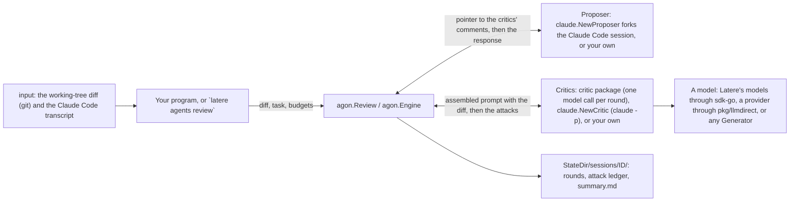

# agon

**agon reviews an agent's code change by debate: independent critics
attack the diff, the agent that wrote it concedes or rebuts each attack,
and you get back only the disputes that survived.** It is a Go library.
You give it the diff, a proposer that defends the change (a forked Claude
Code session, or your own), and the critics (a model call per round, the
`claude` CLI, or your own), and it runs bounded rounds and returns a
summary with the most contested open attack as its headline. Every round
is written to a directory you choose, for audit.

[](https://pkg.go.dev/latere.ai/x/agon)

## Status

agon is before v1.0.0, and a minor release can change its Go API. The
section of each release in the [changelog](CHANGELOG.md) names each
incompatible change. The Latere CLI's `latere agents review` is built on
it. agon has had no external security audit;
[`SECURITY.md`](SECURITY.md#what-is-protected) gives what it protects,
and the test that checks each property.

| Part | State |
|---|---|
| The engine: forks, rounds, the attack ledger, the five ways a run ends, the headline, and the session directory | Works |
| `critic`: a critic that makes one model call per round, through any `critic.Generator` | Works. The tests use a scripted generator |
| `claude`: a proposer that forks a Claude Code session, and a critic that runs `claude -p` | Works with the `claude` CLI. The tests use a fake `claude` |
| `input`: the working-tree diff and the Claude Code transcript | Works |
| Forks in parallel | Not built. Forks run one after another, in the same working tree |
| A public codex critic | Not built. The driver exists inside the module, and no package exports it |
| `agon.Verifier` | An interface only. Nothing implements it |

## Quickstart

You need Go 1.27 or later. The program below runs a whole review with a
critic and a proposer written in the program, so it needs no model, no key
and no `claude` CLI. The critic attacks the change twice, and the
proposer rebuts the attack each time.

```sh
mkdir agon-quickstart && cd agon-quickstart
go mod init quickstart
go get latere.ai/x/agon@latest
cat > main.go <<'EOF'
// Command quickstart runs one agon review with a critic and a proposer
// written in the program, so it needs no model, no key and no claude CLI.
package main

import (
	"context"
	"fmt"
	"log"
	"os"

	"latere.ai/x/agon"
)

const fence = "```"

// critic attacks the change in round 1, attacks it again in round 3, and
// finds nothing new after that. This is the attack format the engine reads.
type critic struct{}

func (critic) Round(_ context.Context, in agon.CriticInput) (*agon.CriticResult, error) {
	doc := fmt.Sprintf("# Critic 1 - round %d attacks\n\naspect: security\n", in.Round)
	if in.Round == 1 || in.Round == 3 {
		header := "## c1-1 [search.go:42]"
		if in.Round == 3 {
			header += " (re-attack)"
		}
		doc += "\n" + header + "\n\n" +
			"claim: The rate limiter keys on the X-Forwarded-For header, so a client can pick its own bucket.\n\n" +
			"expected violation: A client sends a new header value with each request and is never limited.\n\n" +
			"reproduction:\n" + fence + "\ncurl -H 'X-Forwarded-For: 1.2.3.4' localhost:8080/search\n" + fence + "\n"
	}
	return &agon.CriticResult{Markdown: doc}, nil
}

// proposer defends the change. The engine reads lines that start with
// concede, rebut or push-back and an attack id.
type proposer struct{}

func (proposer) FirstRound(context.Context, string) (*agon.ProposerResult, error) {
	return &agon.ProposerResult{ForkID: "fork-1", Response: "rebut c1-1\nThe proxy overwrites the header."}, nil
}

func (proposer) NextRound(_ context.Context, forkID, _ string) (*agon.ProposerResult, error) {
	return &agon.ProposerResult{ForkID: forkID, Response: "push-back c1-1\nThe proxy overwrites the header."}, nil
}

func main() {
	dir, err := os.MkdirTemp("", "agon-quickstart-")
	if err != nil {
		log.Fatal(err)
	}
	defer os.RemoveAll(dir)

	sum, err := agon.Review(context.Background(), agon.ReviewOptions{
		StateDir:    dir,
		Cwd:         dir,
		Forks:       1,
		Proposer:    proposer{},
		NewCritic:   func(int) agon.Critic { return critic{} },
		TaskContext: "Add rate limiting to the search handler.",
		DiffPatch:   "--- a/search.go\n+++ b/search.go\n@@ -42,0 +42,1 @@\n+\tlimiter.Allow(r.Header.Get(\"X-Forwarded-For\"))\n",
	})
	if err != nil {
		log.Fatal(err)
	}
	fmt.Println("termination:", sum.Termination)
	fmt.Println("unresolved: ", sum.Unresolved)
	fmt.Println("headline:   ", sum.Headline)
	for _, f := range sum.Forks {
		fmt.Printf("fork %d:      %s, %d rounds\n", f.Index, f.Topic, f.Rounds)
	}
}
EOF
go run .
```

It prints:

```
termination: max-turn
unresolved:  1
headline:    The rate limiter keys on the X-Forwarded-For header, so a client can pick its own bucket.
fork 1:      security, 6 rounds
```

The attack was rebutted, not conceded, so it stays unresolved and becomes
the headline. The critic attacked again in round 3, so the debate never
settled, and it ended at the round limit. The session directory under
`StateDir` holds each round, the attack ledger and `summary.md`.

## How it fits



- **Your program** computes the diff and calls `agon.Review` (or fills an
  `agon.Engine` for per-fork control). The Latere CLI's
  `latere agents review` is one such program.
- **`input`** reads the working-tree diff with `git` and finds the Claude
  Code transcript of a session under `~/.claude/projects/`.
- **The proposer** answers each fork's critic. `claude.NewProposer` forks
  the real Claude Code session with `claude --resume <id> --fork-session`,
  so it argues with the full context of the change and never writes into
  the original session.
- **The critics** attack the diff, one per fork, each on an aspect it
  declares. The `critic` package sends one model call per round through
  any `critic.Generator`, and `claude.NewCritic` runs `claude -p`.
- **The session directory** under your `StateDir` keeps every round, the
  attack ledger and `summary.md`. agon writes nowhere else and invents no
  default location.

The engine itself imports no model client and no agent runtime. Only the
backends in `claude` and `critic` reach outside your process.

## Wiring a critic

`critic.Config` takes a model connection and a model name. The connection is
any `critic.Generator`, a type with the `Generate` method of the Latere Go
SDK's models client: that client
([`latere.ai/x/sdk-go/llm`](https://pkg.go.dev/latere.ai/x/sdk-go/llm)), a
provider-direct client
([`latere.ai/x/pkg/llmdirect`](https://pkg.go.dev/latere.ai/x/pkg/llmdirect),
in pkg releases after v0.103.0), or your own.

```go
// Through Latere's models, with the key in LATERE_KEY.
cfg, err := latere.NewConfig()
if err != nil {
	return err
}
critics := critic.NewCriticFactory(critic.Config{
	Model: llm.New(cfg),
	Name:  "claude-sonnet-5",
})

// Straight to a provider, with your own key.
direct, err := llmdirect.New(llmdirect.ProviderAnthropic, apiKey, "")
if err != nil {
	return err
}
critics = critic.NewCriticFactory(critic.Config{Model: direct, Name: "claude-sonnet-5"})
```

Each round sends the assembled critic prompt, diff included, as one turn with
no tools, and reports the call's token usage, duration and, when the gateway
reports one, its cost. A round's `CriticInput.Model` overrides `Name`.

## Reviewing a real change

Review the uncommitted changes of a working tree, with a Claude Code session
defending them:

```go
package main

import (
	"context"
	"fmt"
	"log"

	"latere.ai/x/agon"
	"latere.ai/x/agon/claude"
	"latere.ai/x/agon/critic"
	"latere.ai/x/agon/input"
	"latere.ai/x/sdk-go/latere"
	"latere.ai/x/sdk-go/llm"
)

func main() {
	ctx := context.Background()
	const cwd, sessionID = "/path/to/checkout", "claude-session-id"

	diff, err := input.Compute(ctx, input.DiffSpec{From: "HEAD", To: ".", Cwd: cwd})
	if err != nil {
		log.Fatal(err)
	}
	cfg, err := latere.NewConfig() // the key in LATERE_KEY
	if err != nil {
		log.Fatal(err)
	}
	sum, err := agon.Review(ctx, agon.ReviewOptions{
		StateDir:    "/path/to/state",
		Cwd:         cwd,
		Forks:       2,
		Proposer:    claude.NewProposer(sessionID, cwd),
		NewCritic:   critic.NewCriticFactory(critic.Config{Model: llm.New(cfg), Name: "claude-sonnet-5"}),
		TaskContext: "add rate limiting to the search handler",
		DiffPatch:   diff.Patch,
	})
	if err != nil {
		log.Fatal(err)
	}
	fmt.Printf("%s: %d unresolved\n%s\nsee %s\n", sum.Termination, sum.Unresolved, sum.Headline, sum.SessionDir)
}
```

`agon.Engine` is the same machinery with every field exposed, for a caller
that needs per-fork control.

## Documentation

| Page | What you find there |
|---|---|
| [API reference](https://pkg.go.dev/latere.ai/x/agon) | Every exported type and function of `agon`, `claude`, `critic` and `input` |
| [Architecture](specs/022-architecture.md) | The fork and debate model, and the packages |
| [Backends](specs/023-backends.md) | The proposer and critic backends, and their options |
| [Engine API](specs/024-engine-api.md) | The contract for code that embeds the engine |
| [Inputs](specs/025-inputs.md) | Finding the transcript and computing the diff |
| [Debate protocol](specs/026-protocol.md) | Rounds, the attack format, dispositions, termination and the headline |
| [Session format](specs/027-session-format.md) | The files of a session directory |
| [CHANGELOG](CHANGELOG.md) | What changed in each release |

## Contributing

Changes are welcome. [CONTRIBUTING.md](CONTRIBUTING.md) explains how to
set up, run the checks and send a change. Do not report a vulnerability
in an issue: [SECURITY.md](SECURITY.md) says how to report it privately.

## License

[Apache-2.0](LICENSE).
