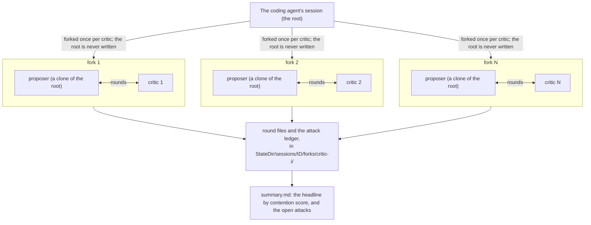

# Architecture

## What Adversarial Review is

Adversarial Review is an **adversarial-review engine and protocol**, shipped as
the Go module `latere.ai/x/agon`. It is not a standalone tool. An embedder gives it a proposer
(the implementation agent, defending a change) and one or more critics (attacking
the change), and it runs a bounded, multi-round debate over the diff and returns a
summary of what survived.

The core idea, from adversarial-debate theory: a change is more trustworthy when
an independent adversary tries and fails to break it than when a single reviewer
nods along. Adversarial Review operationalizes that as a forked, cross-examining
debate whose only human-facing output is the set of unresolved disputes.

## The fork/debate model

- Each critic runs in its own fork; the engine never writes into the root session.
- Within a fork, rounds alternate: odd rounds are the critic, even rounds are the
  proposer. One user-facing "turn" is a critic message plus a proposer reply, so it
  is two internal rounds.
- Each critic declares its own attack topic in round 1 and is then locked to it;
  later forks are told which topics are taken so they pick a different angle.
- Attacks carry stable IDs and are tracked in an append-only ledger. The surfaced
  headline is chosen by a pure contention score, with no model judging that layer.

The protocol itself is [Debate protocol](026-protocol.md).

## Component map

| Layer | Package | Role |
|---|---|---|
| Public API | `agon` | The embedder contract: `Engine`, `Proposer`, `Critic`, `Verifier`, result types. See [engine-api.md](024-engine-api.md). |
| Backends | `claude`, `critic` | Ready-made proposer/critic implementations over the claude CLI and a single model call. See [backends.md](023-backends.md). |
| Inputs | `input` | Locate the Claude transcript, compute the working-tree diff. See [inputs.md](025-inputs.md). |
| Orchestration | `internal/round` | The real round loop, termination detection, signal handling. |
| Protocol | `internal/critic`, `internal/ledger` | Aspect prompts, attack format + parser, the attack ledger. |
| Agents | `internal/agent` | Subprocess drivers for the `claude` and `codex` CLIs. |
| Persistence | `internal/state` | Atomic on-disk session layout. See [session-format.md](027-session-format.md). |
| Output | `internal/summary`, `internal/ansi` | Contention scoring, `summary.md` render, progress styling. |

`agon` re-exports the engine over the `internal/*` packages; its
types carry no `internal/` dependency so out-of-module callers can satisfy the
interfaces. Only `critic` imports a model client (`latere.ai/x/sdk-go/llm`), and
no package depends on an agent runtime, both enforced by a boundary test, so the
model-call critic stays an opt-in backend and the core stays runtime-agnostic.

## Consumers

Adversarial Review is embedded, not run directly:

- **`latere agents review`** (latere-cli) is the developer CLI: it forks the real
  Claude Code session as the proposer and runs the critics through the `critic`
  package on Latere's models, on the user's Latere identity.

The canonical embedding pattern is in [Engine API](024-engine-api.md).

## Non-goals

- **Not a standalone binary.** Adversarial Review is imported as a library. The
  developer CLI lives in latere-cli as `latere agents review`; this tree ships no
  installable of its own.
- **The proposer is not pluggable onto arbitrary runtimes.** It depends on
  `claude --resume <id> --fork-session` to reconstitute the real coding session;
  see [Backends](023-backends.md) for why. Critics are the pluggable layer.
- **No model judging of the surfacing layer.** Headline selection is a pure
  contention score. Models argue; they do not rank the output.
